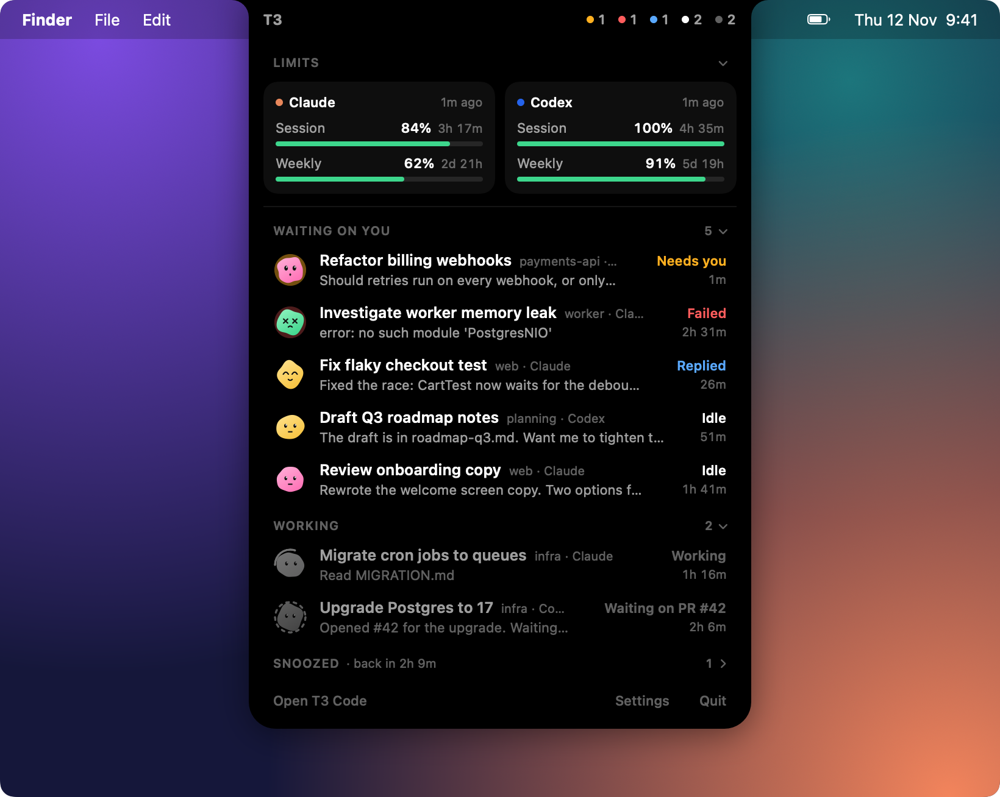
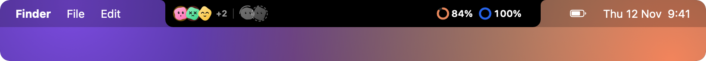
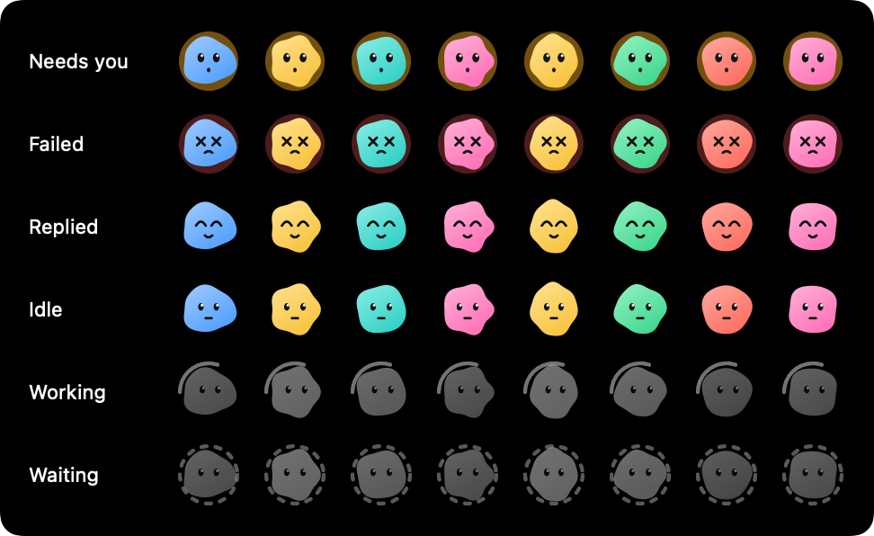

# T3 Island

A small macOS app that hangs a black "island" from the top of the screen, over the notch or in the
middle of the menu bar, showing your T3 Code threads and the usage limits of your agent CLIs.

<p align="center">
  
</p>

<p align="center">
  
</p>

- **Compact:** on the left, faces for threads waiting on you (questions, failures, fresh replies and
  idle unsettled threads), then a divider, then the working threads, up to 3 faces each plus a count.
  On the right, one ring per provider (Claude, Codex) with the quota left in its 5-hour window
  (100% = untouched, 0% = used up); Settings can switch this to the weekly or the lowest window. The number turns amber at 40% left and red at 15%.
  On a display without a notch it sits in the middle of the menu bar:

  
- **Expanded:** click the island. It shows a card per provider (session and weekly windows, time to reset),
  then the threads in sections: waiting on you, working (up to 3 working rows are always kept) and snoozed.
  Under each title, a live line shows what the thread is saying or doing: its latest step while it works
  (`$ swift build`, "Edited Store.swift", "Thinking…"), its question, its error, or the start of its last
  reply. The project and model follow the title.
  A thread whose turn ended to wait for its own agents or a watched pull request counts as working, labelled
  "Waiting on 2 agents" or "Waiting on PR #12", since it isn't your turn yet.
  Click a section title to collapse or expand it, as in T3's sidebar; the choice is remembered. Click a thread to open it in T3. Move the mouse away or click elsewhere to close.
- **Snooze and settle:** hover a thread waiting on you to snooze it (1 hour, 3 hours, tomorrow at 9 or next
  Monday at 9) or settle it, and hover a snoozed thread to wake it. The face reacts first: it falls asleep, or
  smiles with a check. Then the row slides out. The footer offers Undo for a few seconds. Threads with an open
  question have no shortcuts, since they need an answer in T3. While the pointer rests on a row, T3's updates
  wait, so rows never move under a click.
- **Footer** of the expanded island: Open T3 Code, Settings and Quit.

## Settings

Changes apply immediately and are saved in UserDefaults (`defaults delete local.t3island settings` resets them).

- **Limits:** which window the collapsed island shows (5-hour, weekly or lowest), quota left or used, the warn (amber) and critical (red) thresholds, and which providers to show.
- **Threads:** show working threads, threads waiting on you, idle threads, and how many faces per group.
- **Behaviour:** open on hover instead of click, snooze and settle threads (on by default), and launch at login.

Faces follow how much a thread needs you. Needs you (amber pulse), failed, replied (unread result) and
idle (your turn) are in full colour; working threads are greyed out with a spinning ring, since they need
nothing until they finish, and threads waiting on agents or checks are greyed out with a still dashed ring.
Each thread keeps its own blob shape and colour, derived from its id.

<p align="center">
  
</p>

## Build and run

Needs macOS 13+ and Xcode or the Command Line Tools.

```sh
./build-app.sh            # builds build/T3 Island.app
open "build/T3 Island.app"
./build-app.sh --install  # also copies it to ~/Applications
```

To start it at login, run `./build-app.sh --install`, open the installed copy, and turn on
Settings → Launch at login. It registers the copy you turn it on from, so don't use the one in `build/`.

`swift run T3Island --snapshot out/` renders the island states and an avatar gallery to PNGs
using your live data, without opening a window. Add `--demo` to use made-up threads and limits and the default settings
instead, for screenshots you can share; the images in this README are `swift run T3Island --snapshot docs --demo`.
`swift run T3Island --demo` runs the island itself on that data, with one
thread changing state every 2 s, which is handy for checking the update animations.

## Data sources

The app reads T3 Code's local state. Its only network calls go to T3's own server on this Mac, for snoozing and settling.

| What | Where |
| --- | --- |
| Usage limits | `~/.t3/caches/<provider>.json` → `usageLimits`, which T3 refreshes from the Claude and Codex CLIs |
| Threads, runs, pending questions, running agents, watched pull requests | `~/.t3/userdata/statev2.sqlite`, opened read-only and polled every 2 s |
| Live lines | The newest steps of each thread's latest run in the same database, read only while the dropdown is open |
| Thread links | `t3code://threads/<environment-id>/<thread-id>` |
| Snooze and settle | T3's `t3_thread_organize` MCP tool, at the `origin` in `~/.t3/userdata/server-runtime.json` |

Set `T3CODE_HOME` to read a different T3 data directory.

The thread list is T3's inbox: unsettled, unarchived top-level threads, plus any thread that is running
or has an open question. Snoozed threads follow T3's rule: they stay out until the snooze ends, unless a
new question or failure arrives after you snoozed them; the dropdown shows how many are snoozed and when the
next one comes back. The query depends on T3's internal schema, so a T3 update can break it. When that
happens the island shows the SQLite error in its expanded view.

### Signing in to T3

The first snooze or settle signs the island in to T3 as an MCP client named "T3 Island", with no browser.
It runs `~/.t3/bin/t3 auth pairing create` for a one-time code that is valid for two minutes, then approves
and exchanges that code through T3's MCP OAuth endpoints, the way T3 links its own environments. The sign-in
lasts 30 days and then renews itself on the next action.

T3 only lets a client change threads whose runtime mode fits its access level, and threads usually run with
full access, so the island signs in with full access. The token is kept in
`~/Library/Application Support/T3 Island/t3-session.json`, readable only by you. Anything running as you
could already get the same access through the `t3` command, so this file doesn't widen what your account
can do. Turning off Settings → Snooze and settle threads deletes the token and revokes the sign-in in T3.
If you revoke "T3 Island" in T3's Settings → Connections instead, the next action turns the setting off, so
the island doesn't sign itself back in.

## License

MIT, see [LICENSE](LICENSE).
